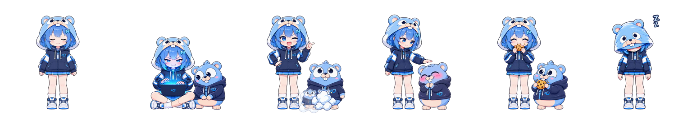
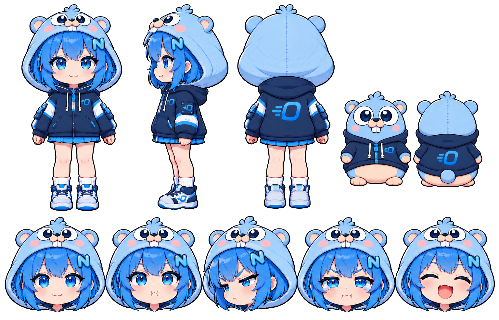
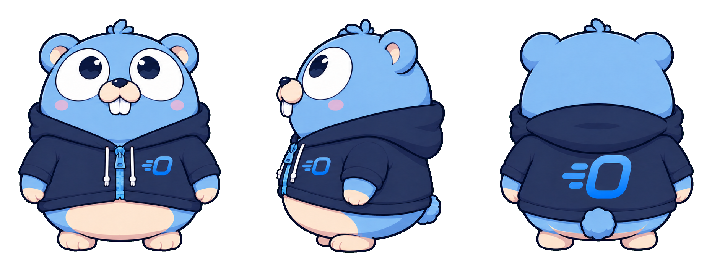

# nsgo-pet

A desktop pet built with [NSGo](https://github.com/nsgo-dev/nsgo), with pets to switch between from the tray icon or the pet's right-click menu. Pets are folders of clips and rules, so adding one needs no code.



 

## What it does

- Lives in a transparent, borderless window without a shadow, floating above other windows on every Space and over full-screen apps.
- Stays off the Dock and the taskbar; a tray icon holds its menu.
- Takes the pointer only on the pet's body: clicks anywhere else in the window reach the window below.
- Greets you, idles, and plays an event every 40 seconds, chosen by each clip's weight and conditions: time of day, season, meals, Gregorian festivals, and whether an editor or a terminal is the app in front.
- Reacts to clicks, dangles while dragged, and walks along the bottom of the screen.
- Starts with NSGo 酱 and remembers the pet you choose; pets from one source share a submenu, and outfits change with the season.

Clips play in two players, the next one loading out of sight, so the pet never blinks out between clips.

## Run

Needs Go 1.27.3 or later. On macOS:

```sh
go tool nsgo dev       # build and open the pet
go tool nsgo test .    # the headless tests
```

Right-click the pet, or use the tray icon, to play an event, move it back to the corner, switch pets or quit.

## Platforms

| Platform | State |
| --- | --- |
| macOS | Runs. Plays the HEVC-with-alpha clips in `mov/`. |
| Linux | Plays the WebM clips; needs GStreamer's `gstreamer1.0-plugins-bad` (codecalpha). The window floats on X11; on Wayland it cannot float or move itself. |
| Windows | Not yet. NSGo's Windows player refuses clips with alpha, so the clips need the app's own decoder feeding `ImageSource.Pixels`. |

## Pets

| Pet | ID | Clips | Source | License |
| --- | --- | --- | --- | --- |
| NSGo 酱 NSGo-chan | `nsgo-chan` | 15 | Drawn for nsgo-pet, with her Gopher, from the sheets in [docs/nsgo-chan](docs/nsgo-chan) | MIT, Copyright (c) 2026 nsgo-dev ([NOTICE](resources/pets/nsgo-chan/NOTICE.md)) |
| 大蓝鱼 Big Blue Fish | `bigbluefish` | 106 | [PC2005-cloud/dsh-pet](https://github.com/PC2005-cloud/dsh-pet), via [Bai-Cute/big-blue-fish-desktop-pet](https://github.com/Bai-Cute/big-blue-fish-desktop-pet) | Character [CC BY-NC-SA 4.0](https://creativecommons.org/licenses/by-nc-sa/4.0/): **no commercial use** ([NOTICE](resources/pets/bigbluefish/NOTICE.md)) |
| Clover | `playpets-clover` | 35 | [gaerae/playpets](https://github.com/gaerae/playpets), with its summer and winter outfits | MIT, gaerae ([NOTICE](resources/pets/playpets-clover/NOTICE.md)) |
| Daisy | `playpets-daisy` | 35 | [gaerae/playpets](https://github.com/gaerae/playpets), with its summer and winter outfits | MIT, gaerae ([NOTICE](resources/pets/playpets-daisy/NOTICE.md)) |
| Pip | `playpets-pip` | 35 | [gaerae/playpets](https://github.com/gaerae/playpets), with its summer and winter outfits | MIT, gaerae ([NOTICE](resources/pets/playpets-pip/NOTICE.md)) |
| Miso | `playpets-miso` | 35 | [gaerae/playpets](https://github.com/gaerae/playpets), with its summer and winter outfits | MIT, gaerae ([NOTICE](resources/pets/playpets-miso/NOTICE.md)) |
| Pip | `pip-mascot` | 13 | [TenzinDhonyoe/pip-mascot](https://github.com/TenzinDhonyoe/pip-mascot) | MIT, Copyright (c) 2026 Tenzin Dhonyoe ([NOTICE](resources/pets/pip-mascot/NOTICE.md)) |
| Mochi | `mochi` | 20 | [miflow13/mochi-desktop](https://github.com/miflow13/mochi-desktop) | MIT, Copyright (c) 2026 Mochi contributors ([NOTICE](resources/pets/mochi/NOTICE.md)) |
| Shimeji | `shimeji` | 14 | [estenv/linux-shimeji](https://github.com/estenv/linux-shimeji), the original Shimeji by Yuki Yamada | zlib, Copyright (c) 2009-2011 Yuki Yamada; altered ([NOTICE](resources/pets/shimeji/NOTICE.md)) |
| OpenPets | `openpets` | 35 | [OpenPetsHQ/openpets](https://github.com/OpenPetsHQ/openpets), with its summer and holidays outfits | MIT, Copyright (c) 2026 OpenPets ([NOTICE](resources/pets/openpets/NOTICE.md)) |
| OpenPets (Halloween) | `openpets-halloween` | 10 | [OpenPetsHQ/openpets](https://github.com/OpenPetsHQ/openpets), its Halloween outfit | MIT, Copyright (c) 2026 OpenPets ([NOTICE](resources/pets/openpets-halloween/NOTICE.md)) |

### Adding a pet

A pet is a folder `resources/pets/<id>/`:

| Path | What it is |
| --- | --- |
| `pet.json` | The pet's name, window size, body and the clips it plays by name |
| `animations.json` | Every clip and when it plays |
| `webm/<clip>.webm` | Each clip as VP9 with alpha, for Linux |
| `mov/<clip>.mov` | The same clip as HEVC with alpha, for macOS, whose player opens no WebM |
| `NOTICE.md` | Where the pet comes from, its authors and its license |

`pet.json`:

```json
{
  "name": "大蓝鱼",
  "width": 320,
  "height": 180,
  "body": { "left": 33, "top": 15, "width": 34, "height": 80 },
  "eventSeconds": 40,
  "clips": {
    "greeting": "女仆屈膝礼仪",
    "exit": "女仆屈膝礼仪",
    "drag": "被鼠标拖拽悬空反馈",
    "idle": "待机呼吸休闲",
    "daily": "晨间刷牙",
    "dailyHour": 23
  },
  "source": "https://github.com/PC2005-cloud/dsh-pet",
  "license": "Character CC BY-NC-SA 4.0 (non-commercial); see NOTICE.md"
}
```

| Field | Meaning |
| --- | --- |
| `width`, `height` | The window in points; clips are fitted into it |
| `body` | Where the pet's body is in the frame, in percent; only there does the window take the pointer |
| `eventSeconds` | Time between events, 40 when left out |
| `clips` | Clip IDs from `animations.json` played by name: on start, on quit, while dragged, as the fallback idle, and once a day at `dailyHour` |

`animations.json` is a list of clips in [Big Blue Fish's format](https://github.com/Bai-Cute/big-blue-fish-desktop-pet/blob/75cd217568e713a7de8812f65dad7072798a8b70/code/BigBlueFish.Windows/assets/fish/animations.json):

| Field | Meaning |
| --- | --- |
| `Id`, `File` | The clip's ID and its WebM file name; the MOV file has the same name |
| `Pool` | `Idle` between events, `Event` every `eventSeconds`, `Click` on a click, `Greeting`, `Daily`, `Drag`, or `Disabled` |
| `Weight` | How likely it is against the others of its pool; 0 never plays unless a condition raises it |
| `NightOnly` | Only from 23:00 to 8:00 |
| `SeasonOnly`, `SummerWeight`, `WinterWeight`, `MorningWeight` | Only in a season, or another weight in summer, in winter or from 8:00 to 11:00 |
| `Meal`, `MealBoost` | `Breakfast`, `Lunch`, `Dinner` or `Any`: the boost is added within an hour of 8:00, 12:00 or 18:00 |
| `Festival`, `RadiusDays`, `FestivalMode`, `FestivalWeight` | Near a festival the weight moves toward `FestivalWeight` (`Triangle`), or is it within `RadiusDays` |
| `WorkKind`, `WorkWeight` | `Coding`: `WorkWeight` while an editor or a terminal is in front |
| `MoveKind`, `HourParity` | `Run` or `Crab`: the pet walks 70 points and back, in the hours whose parity matches, away from the hour's edges |

Clips need a transparent background. From PNG frames with alpha, make both forms with ffmpeg:

```sh
ffmpeg -framerate 24 -i frames/%04d.png -c:v libvpx-vp9 -pix_fmt yuva420p -b:v 0 -crf 32 webm/idle.webm
ffmpeg -c:v libvpx-vp9 -i webm/idle.webm -an -c:v hevc_videotoolbox -alpha_quality 0.75 -q:v 60 -tag:v hvc1 -pix_fmt bgra mov/idle.mov
```

A pet drawn as a Codex sprite sheet (eight columns of 192×208 cells: idle, running, waving, jumping, failed, waiting, working, done) converts in one step: `go run ./tools/codexpet -sheet spritesheet.png -out resources/pets/<id> -name <name> -license <license>` cuts each row into a clip in both forms and writes `pet.json` and `animations.json`; `-summer` and `-winter` add outfits that play in those seasons, and `-group` lists the pet in a submenu.

Each source has a script in `tools/` that fetches its pets again from a pinned commit and converts them:

| Script | Pets |
| --- | --- |
| `tools/fetch-bigbluefish.sh` | Big Blue Fish's 106 clips, transcoding the MOV files |
| `tools/fetch-playpets.sh` | PlayPets' four pets with their summer and winter outfits |
| `tools/fetch-pip-mascot.sh` | Pip, built from its PNG frames |
| `tools/fetch-mochi.sh` | Mochi, built from its PNG frames |
| `tools/fetch-shimeji.sh` | Shimeji, built from its PNG frames |
| `tools/fetch-openpets.sh` | OpenPets' default pet with its outfits |

A pet drawn as PNG frames builds from a JSON spec: `go run ./tools/framepet -spec tools/framepet/pets/<id>.json -frames <dir> -out resources/pets/<id>` plays each clip's frames in order at its frame rate (`"frame.png*4"` holds a frame for four ticks, `"sheet.png#3"` takes the fourth cell of a one-row sheet), crops every clip to the art, writes both forms, and writes `pet.json` and `animations.json` from the spec's rules; `-list` prints the frames a spec uses, which the fetch script downloads before building.

`go tool nsgo test .` checks every pet: its `pet.json` names only clips its `animations.json` has, and every clip ships in both forms.

## Not yet

- Windows playback.
- Lunar festivals (Spring Festival, Lantern, Dragon Boat, Qixi, Mid-Autumn, Laba): their clips keep their plain weight.
- Taking the pointer by the clip's alpha instead of a body rectangle ([nsgo#599](https://github.com/nsgo-dev/nsgo/issues/599)).
- Speech bubbles, weather and the AI agent of the original Big Blue Fish.

## License

The code is MIT, Copyright (c) 2026 nsgo-dev: see [LICENSE](LICENSE). Each pet keeps its own license, listed under [Pets](#pets) and in its `NOTICE.md`: Big Blue Fish's character is CC BY-NC-SA 4.0, so a build that includes it may not be used commercially.
