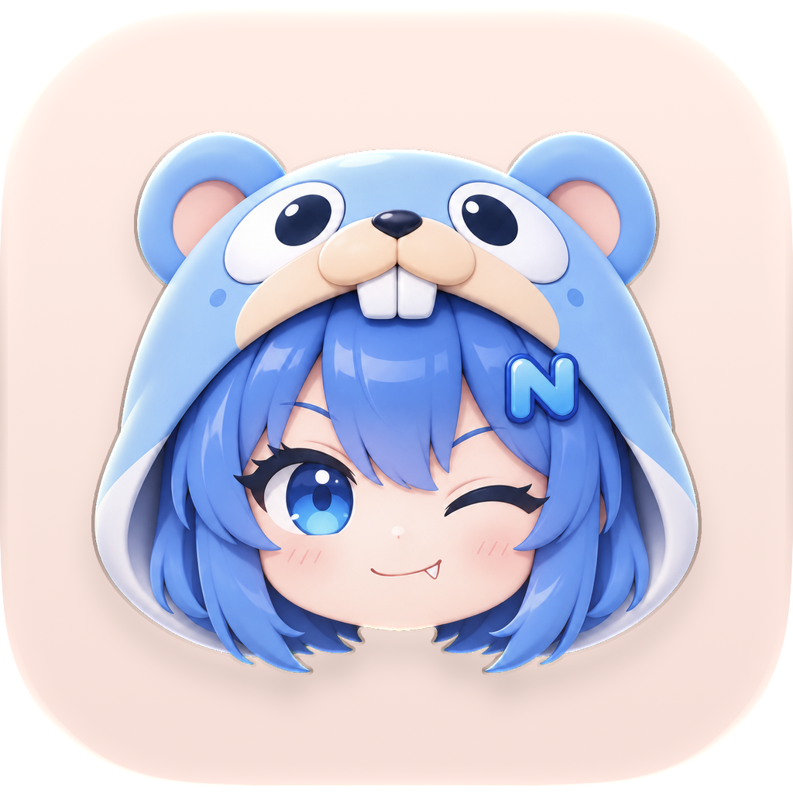

<p align="center">
  
</p>

<h1 align="center">nsgo-pet</h1>

<p align="center">
  <strong>简体中文</strong> |
  <a href="README.md">English</a>
</p>

<p align="center">
  <a href="https://github.com/oneo-me"></a>
  <a href="https://oneo.me"></a>
  <a href="https://x.com/oneo666"></a>
  <a href="https://github.com/sponsors/oneo-me"></a>
</p>

<p align="center">
  用 <a href="https://github.com/nsgo-dev/nsgo">NSGo</a> 做的 macOS 和 Linux 桌宠，以及它背后的宠物引擎，其他 NSGo 应用也能嵌入。
</p>

<p align="center">
  
</p>

## 功能

- 浮在透明窗口里，位于其他窗口之上，出现在每个桌面空间和全屏应用上方，不占程序坞和任务栏。
- 只有宠物身体处接收指针，点在其他地方会落到下面的窗口。
- 会打招呼、待机，并按时段、季节、饭点、节日以及前台是否为编辑器或终端来播放事件。
- 点击有反应，拖拽时悬空晃动，还会沿屏幕底部走动。
- 可从托盘图标或右键菜单在 11 只宠物间切换，并记住你的选择。
- 从本仓库的发布版自动更新。

## 安装

从 [发布页](https://github.com/nsgo-dev/nsgo-pet/releases) 下载 macOS 的磁盘映像，或 Linux 的 Debian 包、Arch 包或 AppImage。首个版本发布前，在仓库根目录用 `go tool nsgo build` 构建，产物写到 `dist/`。

Linux 播放带透明通道的动画需要 GStreamer 的 bad 插件（`gstreamer1.0-plugins-bad`），Debian 包和 Arch 包已依赖它。

## 快速开始

1. 打开 nsgo-pet，NSGo 酱会在屏幕右下角跟你打招呼。
2. 把她拖到任意位置，或点她一下看反应。
3. 右键点她，或用 🐾 托盘图标，可以切换宠物、来点动作、回到右下角、检查更新或退出。

## 嵌入宠物引擎

引擎是 Go 模块 `github.com/nsgo-dev/nsgo-pet/pet`：包含宠物包格式、动画规则和播放它们的视图。它不带任何宠物和素材，由你的应用自带宠物包，各包遵循各自的许可。

```sh
go get github.com/nsgo-dev/nsgo-pet/pet@main
```

从目录加载宠物包，或用 `pet.Load(fsys, "asset:pets")` 从应用资源加载。加载失败的包会被跳过，并在错误里写明：

```go
packs, err := pet.LoadDir(dir)
if len(packs) == 0 {
	return err
}
```

把宠物作为一个视图放进你自己的布局：

```go
func Sidebar(cx *core.Scope) core.Node {
	p := pet.New(cx, packs[0], pet.Options{
		Menu:    menu,
		Context: func() pet.Context { return pet.Context{Working: busy.Get()} },
	})
	cx.Post(p.Start)
	return p.View()
}
```

或放进它自己的窗口，走动和拖拽会移动这个窗口：

```go
desktop.OpenWindow(cx, pet.WindowOptions(pack), func(cx *core.Scope) core.Node {
	p := pet.New(cx, pack, pet.Options{Window: true, Menu: menu})
	cx.Post(p.Start)
	return p.View()
})
```

窗口、菜单和生命周期都归你的应用管。引擎不建托盘、不检查更新、不存任何东西，也不会退出应用。

| 调用 | 作用 |
| --- | --- |
| `Act` | 立即播放一个事件 |
| `Play(id)` | 按 ID 播放动画，比如对应你应用的运行中、等待或完成状态 |
| `PlaceAtCorner` | 把宠物自己的窗口移到屏幕右下角 |
| `Leave(done)` | 播放退场动画后调用 `done`，在里面关闭宠物的窗口或视图 |

`Options.Context` 告诉动画的 `Working` 和 `Coding` 权重用户在做什么；不提供时宠物会看前台应用。如何制作宠物包见 [宠物包格式](docs/architecture/packs.md)。

## 宠物

| 宠物 | ID | 动画数 | 来源 | 许可 |
| --- | --- | --- | --- | --- |
| NSGo 酱 NSGo-chan | `nsgo-chan` | 15 | 为 nsgo-pet 绘制，连同她的 Gopher，设定图见 [docs/nsgo-chan](docs/nsgo-chan) | MIT, Copyright (c) 2026 nsgo-dev（[NOTICE](resources/pets/nsgo-chan/NOTICE.md)） |
| 大蓝鱼 Big Blue Fish | `bigbluefish` | 106 | [PC2005-cloud/dsh-pet](https://github.com/PC2005-cloud/dsh-pet)，经由 [Bai-Cute/big-blue-fish-desktop-pet](https://github.com/Bai-Cute/big-blue-fish-desktop-pet) | 角色 [CC BY-NC-SA 4.0](https://creativecommons.org/licenses/by-nc-sa/4.0/)：**不得商用**（[NOTICE](resources/pets/bigbluefish/NOTICE.md)） |
| Clover | `playpets-clover` | 35 | [gaerae/playpets](https://github.com/gaerae/playpets)，含夏装和冬装 | MIT, gaerae（[NOTICE](resources/pets/playpets-clover/NOTICE.md)） |
| Daisy | `playpets-daisy` | 35 | [gaerae/playpets](https://github.com/gaerae/playpets)，含夏装和冬装 | MIT, gaerae（[NOTICE](resources/pets/playpets-daisy/NOTICE.md)） |
| Pip | `playpets-pip` | 35 | [gaerae/playpets](https://github.com/gaerae/playpets)，含夏装和冬装 | MIT, gaerae（[NOTICE](resources/pets/playpets-pip/NOTICE.md)） |
| Miso | `playpets-miso` | 35 | [gaerae/playpets](https://github.com/gaerae/playpets)，含夏装和冬装 | MIT, gaerae（[NOTICE](resources/pets/playpets-miso/NOTICE.md)） |
| Pip | `pip-mascot` | 13 | [TenzinDhonyoe/pip-mascot](https://github.com/TenzinDhonyoe/pip-mascot) | MIT, Copyright (c) 2026 Tenzin Dhonyoe（[NOTICE](resources/pets/pip-mascot/NOTICE.md)） |
| Mochi | `mochi` | 20 | [miflow13/mochi-desktop](https://github.com/miflow13/mochi-desktop) | MIT, Copyright (c) 2026 Mochi contributors（[NOTICE](resources/pets/mochi/NOTICE.md)） |
| Shimeji | `shimeji` | 14 | [estenv/linux-shimeji](https://github.com/estenv/linux-shimeji)，原版 Shimeji 作者 Yuki Yamada | zlib, Copyright (c) 2009-2011 Yuki Yamada；已修改（[NOTICE](resources/pets/shimeji/NOTICE.md)） |
| OpenPets | `openpets` | 35 | [OpenPetsHQ/openpets](https://github.com/OpenPetsHQ/openpets)，含夏装和节日装 | MIT, Copyright (c) 2026 OpenPets（[NOTICE](resources/pets/openpets/NOTICE.md)） |
| OpenPets（万圣节） | `openpets-halloween` | 10 | [OpenPetsHQ/openpets](https://github.com/OpenPetsHQ/openpets)，其万圣节装 | MIT, Copyright (c) 2026 OpenPets（[NOTICE](resources/pets/openpets-halloween/NOTICE.md)） |

## 平台

| 平台 | 状态 |
| --- | --- |
| macOS | 可运行，播放带透明通道的 HEVC 动画。 |
| Linux | 播放 WebM 动画。X11 下窗口可浮动；Wayland 下不能浮动，也不能自己移动。 |
| Windows | 暂不支持：NSGo 的 Windows 播放器拒绝带透明通道的视频。 |

农历节日、按动画透明度判定点击（[nsgo#599](https://github.com/nsgo-dev/nsgo/issues/599)）、对话气泡和天气还没做。

## 开发

需要 Go 1.27.3 或更高版本。在仓库根目录：

```sh
go tool nsgo dev           # build and open the pet
go tool nsgo test .        # the app's headless tests, which check every pet in resources/pets
(cd pet && go test ./...)  # the engine's tests
```

发布时，把 `CHANGELOG.md` 里 `Unreleased` 下的条目移到 `## [<版本>] - <日期>` 下，把 `nsgo.yaml` 的 `version` 设为同一版本，然后推送标签 `v<版本>`。[发布工作流](.github/workflows/release.yml) 会构建、签名并发布安装包，以该节作为发布说明。

修改代码前请先读 [ARCHITECTURE.md](ARCHITECTURE.md)，Agent 的协作方式见 [AGENTS.md](AGENTS.md)。变更记录见 [CHANGELOG.md](CHANGELOG.md)。

## 许可证

代码（应用和引擎）采用 MIT 许可，Copyright (c) 2026 nsgo-dev，见 [LICENSE](LICENSE)。每只宠物保留各自的许可，列在 [宠物](#宠物) 和各自的 `NOTICE.md` 中。大蓝鱼的角色采用 CC BY-NC-SA 4.0，因此包含它的构建不得商用。
